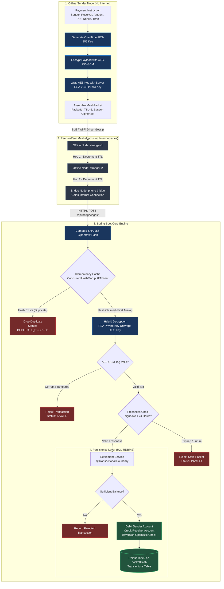

<div align="center">

# UPI Offline Mesh Enterprise

### Cryptographically Secured, Zero-Connectivity Payment Relay via Epidemic Mesh Routing & Idempotent Backend Settlement

An enterprise-grade architectural simulation demonstrating how peer-to-peer financial messages can traverse air-gapped, zero-connectivity environments across untrusted intermediate devices before settling idempotently on a Spring Boot banking core.

<br/>

[](https://www.oracle.com/java/)
[](https://spring.io/projects/spring-boot)
[](https://maven.apache.org/)
[](https://www.docker.com/)
[](https://upi-offline-internet.onrender.com)
[](https://github.com/miteshlohar2005/UPI-Offline-Internet)

<br/>

[**Explore Live Demo**](https://upi-offline-internet.onrender.com) &nbsp;•&nbsp; [**View Source Code**](https://github.com/miteshlohar2005/UPI-Offline-Internet) &nbsp;•&nbsp; [**Architecture**](#system-architecture) &nbsp;•&nbsp; [**API Docs**](#api-reference) &nbsp;•&nbsp; [**Local Setup**](#quick-start--local-execution)

</div>

---

> [!IMPORTANT]
> **Engineering Prototype Disclaimer:** This system is an independent software simulation illustrating distributed mesh routing, payload authentication, and idempotent ingestion semantics. It is **not** an officially endorsed NPCI (National Payments Corporation of India) product or real-world banking integration.

---

## Executive Overview

### The Problem
Traditional Unified Payments Interface (UPI) transactions require persistent, round-trip internet connectivity between the customer application, payment service provider (PSP), NPCI switch, and issuing bank. In subterranean transit stations, rural corridors, congested event arenas, or during network infrastructure outages, transactions fail completely because neither the sender nor receiver can establish an uplink.

### The Solution
**UPI Offline Mesh Enterprise** provides an offline-first payment message routing model:
1. **Air-Gapped Payment Generation:** The sender’s device generates a signed transaction cryptographically encrypted with the core server’s public key.
2. **Untrusted Epidemic Relay:** The ciphertext packet hops hop-by-hop across local devices over an emulated peer-to-peer mesh with Time-To-Live (TTL) decrement counters. Relaying devices carry the packet without ability to inspect or tamper with transaction contents.
3. **Opportunistic Ingestion & Deferred Settlement:** Once any device in the mesh ("Bridge Node") gains cellular or Wi-Fi uplink, it forwards accumulated packets to the backend ingestion gateway.
4. **Guaranteed Atomic Idempotency:** The backend ingests, deduplicates concurrent multi-bridge deliveries via atomic SHA-256 ciphertext hash locks, authenticates AES-GCM tags, checks cryptographic freshness, and executes atomic double-entry ledger transfers.

---

## Key Features

### Mesh Networking & Topology Simulation
- **Epidemic Gossip Relay:** Configurable multi-hop packet diffusion across virtual node networks with automated hop-count tracking and Time-To-Live (TTL) enforcement.
- **Dynamic Bridge Uplinks:** Simulates roaming devices that transition from air-gapped mesh participants to active network bridges that flush buffered packets to cloud APIs.
- **Concurrent Bridge Flush:** Parallel delivery simulation where multiple bridge nodes submit the exact same packet simultaneously to test real-world duplicate-storm conditions.

### Core Payment Processing & Ingestion
- **Pipeline Architecture:** Ingestion pipeline partitioned into distinct processing gates: Hash &rarr; Idempotency Claim &rarr; Hybrid Decryption &rarr; Replay Window Verification &rarr; Ledger Settlement.
- **Atomic Balance Mutation:** ACID-compliant ledger updates utilizing Spring `@Transactional` boundaries with JPA `@Version` optimistic locking on user accounts.
- **Two-Phase Rejection Guard:** Rejects malformed, tampered, expired, or balance-deficient transactions while recording audit trails with assigned transaction references.

### Cryptography & Security Engineering
- **Hybrid Encryption Scheme:** Combines asymmetric **RSA-2048 (OAEP padding with SHA-256 and MGF1)** for session key encapsulation with symmetric **AES-256-GCM** for high-throughput authenticated payload encryption.
- **Authenticated Integrity Verification:** AES-GCM 128-bit authentication tags ensure that any single-bit manipulation across intermediate mesh nodes results in immediate rejection before ledger processing.
- **Ciphertext Hash Idempotency:** Deduplicates transactions on the SHA-256 digest of the raw base64 ciphertext rather than mutable outer packet metadata or unverified cleartext.
- **Replay & Freshness Protection:** Strict monotonic freshness windows (`signedAt` validation against configurable TTL thresholds) combined with cryptographically bound UUID nonces prevent capture-and-replay attacks.

### Enterprise Web Dashboard
- **Live Mission Control:** Interactive controls to compose offline payments, trigger step-wise gossip rounds, initiate parallel bridge flushes, and reset mesh state.
- **8-Stage Payment Journey Tracker:** Visual pipeline tracking transaction progression from device creation to cryptographic encapsulation, mesh hops, bridge uplink, verification, and settlement.
- **Canvas-Based Topology Engine:** HTML5 Canvas visualizer rendering active nodes, bridge states, interactive packet counts, and live node pulses.
- **Real-Time Chart.js Analytics:** Six dedicated telemetry visualizations monitoring settlement trends, packet distribution, hop count distribution, duplicate drop ratios, bridge utilization, and network traffic volume.
- **Cybersecurity & Audit Ledger:** Live display of encryption keypair state, cache size, tamper detection status, and chronological audit tables.

### Containerization & Cloud Deployment
- **Multi-Stage Container Image:** Lightweight Alpine Linux container utilizing Eclipse Temurin JRE 17 with non-root security execution.
- **Cloud-Native Port Resolution:** Seamless environment port binding via `${PORT:-8080}` for automatic deployment on PaaS platforms such as Render.

---

## System Architecture

The following diagram illustrates the lifecycle of an offline transaction traveling through untrusted intermediaries to final backend settlement:



---

## Technical Challenges & Engineering Solutions

### 1. Zero-Trust Routing Across Untrusted Intermediaries
* **Challenge:** Intermediary devices carrying payment messages must be treated as hostile. Any intermediate party could attempt to inspect balances, modify payment recipients, alter amounts, or forge transactions.
* **Solution:** The sender performs hybrid authenticated encryption prior to broadcasting into the mesh:
  $$\text{Payload} = \text{AES-GCM-256}_{K_{\text{session}}}(\text{PaymentJSON})$$
  $$K_{\text{enc}} = \text{RSA-OAEP-2048}_{K_{\text{server\_public}}}(K_{\text{session}})$$
  $$\text{Wire Format} = [\, K_{\text{enc}} \ (256\text{B}) \,] \parallel [\, \text{IV} \ (12\text{B}) \,] \parallel [\, \text{Ciphertext} \,] \parallel [\, \text{GCM Tag} \ (16\text{B}) \,]$$
  Because only the central banking server possesses the private RSA key, intermediary devices cannot read the payload. Because AES-GCM includes an authenticated Galois tag across the ciphertext, any modification of even a single bit immediately invalidates the tag during decryption and triggers rejection.

### 2. Multi-Bridge Ingestion Storms (Idempotency)
* **Challenge:** In mesh topologies, epidemic gossip replicates identical packets to multiple nodes. When connectivity is restored, multiple bridge devices upload the same packet simultaneously within milliseconds.
* **Solution:** The server uses an atomic compare-and-set gate over the **SHA-256 digest of the ciphertext** prior to executing decryption or database lookups:
  ```java
  public boolean claim(String packetHash) {
      Instant now = Instant.now();
      Instant prev = seen.putIfAbsent(packetHash, now);
      return prev == null; // Exactly one thread succeeds across concurrent attempts
  }
  ```
  - **Why hash the ciphertext?** Cleartext is unavailable before decryption (which is CPU intensive), and external `packetId` fields can be spoofed or mutated by intermediate nodes. The ciphertext is cryptographically tied to the transaction.
  - **Defense-in-Depth:** In addition to the in-memory cache, the database enforces a `UNIQUE` constraint on `transactions.packet_hash`, ensuring that even under cluster synchronization failures, duplicate ledger writes fail at the database transaction boundary.

### 3. Replay Protection & Monotonic Freshness
* **Challenge:** An attacker intercepting an immutable, validly encrypted packet might replay it days or weeks later to drain a sender's balance repeatedly.
* **Solution:**
  - **Cryptographic Nonce:** Each `PaymentInstruction` contains a cryptographic UUID nonce generated at the time of creation. Two legitimate transactions with identical parameters produce distinct nonces, distinct ciphertexts, and distinct hashes.
  - **Bounded Freshness Window:** Every packet carries an unforgeable millisecond timestamp (`signedAt`) sealed inside the authenticated ciphertext. During ingestion, the server asserts that:
    $$-300\text{s} \le (T_{\text{server}} - T_{\text{signedAt}}) \le 86,400\text{s}$$
    Packets outside the allowable 24-hour window (or exhibiting clock skew exceeding 5 minutes into the future) are rejected immediately.

---

## Technology Stack

| Domain | Technology / Library | Version | Engineering Role |
| :--- | :--- | :--- | :--- |
| **Language & Runtime** | Java OpenJDK | 17 LTS | Core application execution environment |
| **Backend Framework** | Spring Boot | 3.3.5 | Ingestion API, transaction boundaries, dependency injection |
| **Persistence & ORM** | Spring Data JPA / Hibernate | 3.3.5 | Relational data mapping, optimistic locking, ledger persistence |
| **Database** | H2 Database Engine | Runtime | Embedded in-memory SQL database with web console |
| **Security & Crypto** | Java Cryptography Extension (JCE) | JDK Built-in | RSA-OAEP (SHA-256/MGF1), AES-256-GCM, SHA-256 message digests |
| **Template Engine** | Thymeleaf | 3.3.5 | Server-rendered enterprise management dashboard |
| **Frontend Utilities** | Chart.js & GSAP | Latest CDN | Real-time metric visualizations and smooth transition animations |
| **Iconography** | Lucide Icons | Latest CDN | Clean enterprise iconography |
| **Containerization** | Docker (Alpine Linux) | Multi-Stage | Minimalist, unprivileged container execution image |
| **Cloud Hosting** | Render PaaS | Cloud | Container-based deployment with automatic TLS termination |
| **Testing** | JUnit 5 & Spring Test | 5.10 | Multi-threaded concurrency testing and cryptographic validation |

---

## Dashboard Walkthrough

The web dashboard at `http://localhost:8080` provides a comprehensive mission-control interface to simulate and observe the full distributed lifecycle:

1. **Mission Control:**
   - **Sender/Receiver Selection:** Choose from pre-seeded accounts (`alice@demo`, `bob@demo`, `carol@demo`, `dave@demo`).
   - **Inject:** Simulates offline mobile device signing, generating AES key, encrypting payload, and loading packet into local device storage.
   - **Gossip Round:** Simulates peer device discovery; decrements TTL and copies packets to all adjacent peer devices in the mesh.
   - **Bridge Upload:** Simulates roaming bridge devices obtaining 4G/Wi-Fi and executing concurrent uploads to `/api/bridge/ingest`.
   - **Reset Mesh:** Wipes virtual device storage and flushes the server idempotency cache.
2. **Payment Journey Tracker:** An 8-step visual state tracker tracing the progression of an in-flight payment from creation, encryption, local mesh transmission, bridge discovery, cloud uplink, verification, to final ledger credit.
3. **Interactive Network Topology:** An HTML5 Canvas rendering device nodes, displaying active packet queues, internet uplink indicators, and animated data transmission pulses.
4. **Live Metric Cards:** Telemetry tiles summarizing Created Packets, Settled Count, Dropped Duplicate Count, Average Hops Traveled, Bridge Uploads, and System Success Rate.
5. **Real-Time Analytics Grid:** Six live Chart.js charts plotting Settlement Trends, Packet Distribution per Node, Hop Frequency, Duplicate Detection Ratios, Bridge Utilization, and Overall Traffic.
6. **Live Ledger & Packet Inspector:** Real-time synchronized account balance tables, recent transaction ledger entries, and a deep-inspection modal showing wire-level ciphertext and computed hashes.

---

## Live Deployment

The application is deployed as a live cloud container service:

* **Live Demo URL:** [https://upi-offline-internet.onrender.com](https://upi-offline-internet.onrender.com)
* **Hosting Platform:** Render (Docker Web Service)
* **Configuration:** Built from repository root [Dockerfile](file:///c:/Users/lohar/Documents/UPI_Without_Internet/Dockerfile) on Alpine Linux runtime.

> [!NOTE]
> **Free Tier Infrastructure Notes:**
> - **Cold Starts:** Instances automatically spin down during periods of inactivity. Initial page requests may require 30–50 seconds to boot the JVM container.
> - **Ephemeral Storage:** The demo runs with an in-memory H2 database and in-memory idempotency cache; data and balances automatically reset on container restart.

---

## Quick Start & Local Execution

### Prerequisites
- **JDK 17 or newer** (`java -version`)
- Standard command line (`PowerShell` on Windows, `bash` or `zsh` on Linux/macOS)
- *Note:* Maven is not required to be pre-installed; the included Maven wrapper (`mvnw` / `mvnw.cmd`) handles distribution downloads automatically.

### Running via Maven Wrapper

#### Windows (PowerShell)
```powershell
# Clone the repository
git clone https://github.com/miteshlohar2005/UPI-Offline-Internet.git
cd UPI-Offline-Internet

# Run Spring Boot application
.\mvnw.cmd spring-boot:run
```

#### Linux / macOS
```bash
# Clone the repository
git clone https://github.com/miteshlohar2005/UPI-Offline-Internet.git
cd UPI-Offline-Internet

# Ensure execution permissions on the wrapper script
chmod +x ./mvnw

# Run Spring Boot application
./mvnw spring-boot:run
```

Once the terminal outputs:
```text
Started UpiMeshApplication in X.XXX seconds (process running for X.XXX)
Tomcat started on port 8080 (http) with context path '/'
```
Open your browser and navigate to:
**`http://localhost:8080`**

---

## Docker Deployment

A lightweight, multi-stage Docker build is provided for containerized environments.

### Build and Run with Docker

```bash
# 1. Build the production Docker image
docker build -t upi-offline-mesh:latest .

# 2. Run container on local port 8080
docker run -d -p 8080:8080 --name upi-mesh-app upi-offline-mesh:latest

# 3. View live container logs
docker logs -f upi-mesh-app
```

### Dockerfile Breakdown
- **Build Stage:** `maven:3.9.9-eclipse-temurin-17-alpine` downloads dependencies and compiles an optimized fat JAR.
- **Runtime Stage:** `eclipse-temurin:17-jre-alpine` creates an unprivileged system user (`appuser`), isolates filesystem permissions, exposes port `8080`, and configures container memory management (`-XX:+UseContainerSupport -XX:MaxRAMPercentage=75.0`).

---

## API Reference

The backend exposes RESTful endpoints supporting both the simulation interface and production-style bridge gateways:

| HTTP Method | Endpoint | Headers / Payload | Description |
| :--- | :--- | :--- | :--- |
| `GET` | `/` | None | Renders the enterprise Thymeleaf web dashboard. |
| `GET` | `/api/server-key` | None | Returns the active 2048-bit RSA public key (base64) and cryptographic specifications. |
| `POST` | `/api/bridge/ingest` | `X-Bridge-Node-Id: <id>`<br/>`X-Hop-Count: <int>`<br/>JSON: `MeshPacket` | **Production Ingestion Gateway.** Ingests mesh packets delivered by bridge nodes, deduplicating, verifying, and settling transactions. |
| `POST` | `/api/demo/send` | JSON: `DemoSendRequest` | Simulates offline phone payment generation, RSA/AES hybrid encryption, and local device injection. |
| `GET` | `/api/mesh/state` | None | Returns real-time status of all virtual devices, held packet counts, and idempotency cache size. |
| `POST` | `/api/mesh/gossip` | None | Triggers one discrete gossip round across virtual devices, decrementing TTLs. |
| `POST` | `/api/mesh/flush` | None | Simulates all internet-capable bridge devices concurrently executing parallel uploads. |
| `POST` | `/api/mesh/reset` | None | Resets virtual node storage and purges the server idempotency cache. |
| `GET` | `/api/accounts` | None | Lists all user accounts, VPA identifiers, and current ledger balances. |
| `GET` | `/api/transactions`| None | Retrieves the 20 most recent ledger transactions with status and hop counts. |
| `GET` | `/h2-console` | JDBC: `jdbc:h2:mem:upimesh` | Built-in H2 database console (User: `sa`, Password: empty). |

### Production Ingestion Payload Example

```http
POST /api/bridge/ingest HTTP/1.1
Host: localhost:8080
Content-Type: application/json
X-Bridge-Node-Id: phone-bridge
X-Hop-Count: 3

{
  "packetId": "d3b07384-d113-494a-9c8e-8a7e0a3c2001",
  "ttl": 2,
  "createdAt": 1730000000000,
  "ciphertext": "AQAQ...[Base64 Encrypted RSA Encapsulated Key + IV + AES-GCM Ciphertext + Tag]..."
}
```

#### Response (Settled):
```json
{
  "outcome": "SETTLED",
  "packetHash": "c230f515847c0b296dfa28399e527e5ecf9bb34b3f2f01f2780e12b7f0c18d1a",
  "reason": null,
  "transactionId": 1
}
```

#### Response (Duplicate Dropped):
```json
{
  "outcome": "DUPLICATE_DROPPED",
  "packetHash": "c230f515847c0b296dfa28399e527e5ecf9bb34b3f2f01f2780e12b7f0c18d1a",
  "reason": null,
  "transactionId": null
}
```

---

## Testing & Verification

The test suite includes multi-threaded concurrency validations and cryptographic round-trip tests located in `src/test/java/com/demo/upimesh/IdempotencyConcurrencyTest.java`.

### Executing Tests
```powershell
# Windows
.\mvnw.cmd test

# Linux / macOS
./mvnw test
```

### Verified Scenarios
| Test Method | Verification Target | Status |
| :--- | :--- | :--- |
| `singlePacketDeliveredByThreeBridgesSettlesExactlyOnce` | Fires 3 concurrent executor threads simultaneously delivering the exact same packet. Asserts that exactly 1 transaction settles, 2 are dropped as duplicates, and the sender's account balance is decremented exactly once. | **Passing (0 Failures)** |
| `tamperedCiphertextIsRejected` | Flips an arbitrary bit within the AES-GCM ciphertext string. Asserts that the ingestion pipeline catches tag failure, returns `INVALID`, and leaves balances untouched. | **Passing (0 Failures)** |
| `encryptDecryptRoundTrip` | Validates that serialized `PaymentInstruction` records match exactly after RSA key unwrapping and AES-GCM payload decryption. | **Passing (0 Failures)** |

---

## Repository Structure

```
UPI_Without_Internet/
├── Dockerfile                             # Multi-stage Docker build configuration
├── .dockerignore                          # Build context exclusion rules
├── pom.xml                                # Maven dependencies & Spring Boot build plugins
├── mvnw / mvnw.cmd                        # Cross-platform Apache Maven wrappers
├── README.md                              # Technical project documentation
└── src/
    ├── main/
    │   ├── java/com/demo/upimesh/
    │   │   ├── UpiMeshApplication.java    # Spring Boot application entry point
    │   │   ├── config/
    │   │   │   └── AppConfig.java         # Scheduling configuration for cache cleanup
    │   │   ├── controller/
    │   │   │   ├── ApiController.java     # REST API endpoints (bridge, simulation, ledger)
    │   │   │   └── DashboardController.java# Web UI route handler
    │   │   ├── crypto/
    │   │   │   ├── HybridCryptoService.java # RSA-2048 OAEP + AES-256 GCM engine
    │   │   │   └── ServerKeyHolder.java   # RSA keypair management
    │   │   ├── model/
    │   │   │   ├── Account.java           # JPA account entity with optimistic locking
    │   │   │   ├── AccountRepository.java # Spring Data JPA account repository
    │   │   │   ├── MeshPacket.java        # Wire format packet wrapper
    │   │   │   ├── PaymentInstruction.java# Decrypted transaction payload
    │   │   │   ├── Transaction.java       # Immutable ledger transaction entity
    │   │   │   └── TransactionRepository.java # Spring Data JPA transaction repository
    │   │   └── service/
    │   │       ├── BridgeIngestionService.java # Ingestion orchestration & verification pipeline
    │   │       ├── DemoService.java       # Seed account generator & sender simulator
    │   │       ├── IdempotencyService.java# Atomic putIfAbsent hash cache
    │   │       ├── MeshSimulatorService.java   # Epidemic gossip router & virtual devices
    │   │       ├── SettlementService.java # Transactional balance transfer service
    │   │       └── VirtualDevice.java     # Model of an offline or bridge node
    │   └── resources/
    │       ├── application.properties     # Port, H2, and cache TTL configuration
    │       ├── static/
    │       │   ├── css/style.css          # Glassmorphic enterprise styling
    │       │   ├── js/
    │       │   │   ├── app.js             # Client controller, charts & telemetry
    │       │   │   └── topology.js        # Canvas mesh network visualizer
    │       │   └── videos/
    │       │       └── mesh-background.mp4# Ambient background visual
    │       └── templates/
    │           └── dashboard.html         # Thymeleaf dashboard interface
    └── test/
        └── java/com/demo/upimesh/
            └── IdempotencyConcurrencyTest.java # Concurrency & cryptographic unit tests
```

---

## Production Considerations & Inherent Limitations

To maintain engineering transparency, the following technical tradeoffs and limitations are documented:

1. **Deferred Settlement vs. Instant Authorization:**
   - In a purely offline transaction, the receiver's phone cannot query the issuing bank's balance in real time. Until a bridge node connects to the internet, the transaction remains an optimistic authorization. If the sender's balance is insufficient when the packet reaches the core server, the settlement is rejected.
   - *Production Countermeasure:* In real-world offline payment designs (such as RBI-approved UPI Lite), offline spending requires a **pre-allocated, hardware-backed secure wallet balance** enforced by device cryptographic hardware (Secure Element / Android Keystore).
2. **Offline Double-Spending Vectors:**
   - Without a centralized consensus lock, a malicious actor in an air-gapped area could broadcast two conflicting transactions totaling more than their balance to two distinct offline merchants. Whichever packet reaches a bridge node first will settle; the second will be rejected.
3. **Simulated vs. Physical BLE Mesh Routing:**
   - Real-world Bluetooth Low Energy (BLE) peripheral advertising is heavily throttled by mobile operating systems (iOS background peripheral restrictions, Android Doze mode battery optimization). This repository intentionally simulates mesh transport in software to isolate and demonstrate the backend cryptography and idempotency architecture.
4. **Persistence & Key Management:**
   - **Database:** Uses an embedded in-memory H2 database for zero-dependency execution. Production deployments require an external, highly available relational database (PostgreSQL / MySQL).
   - **Keypair Lifecycle:** `ServerKeyHolder` generates a fresh RSA-2048 keypair on startup. A production system requires persistent private key management within an HSM (Hardware Security Module) or cloud KMS (e.g., AWS KMS, HashiCorp Vault), with distributed public key caching on client applications.
   - **Distributed Idempotency:** The JVM-level `ConcurrentHashMap` in `IdempotencyService` is designed to be replaced by a distributed Redis cluster using atomic `SET <hash> <timestamp> NX EX 86400` commands across multiple server instances.

---

## Technical Roadmap

- [ ] **Distributed Cache Provider:** Add Spring Data Redis abstraction layer alongside the in-memory cache.
- [ ] **Digital Signatures on Sender Payloads:** Introduce Ed25519 / ECDSA client-side signing to verify non-repudiation of sender identities.
- [ ] **Android Prototype Client:** Provide an open-source Android client leveraging Google Nearby Connections API or BLE GATT for physical mesh evaluation.
- [ ] **Rate Limiting & Bridge mTLS:** Implement mutual TLS authentication and token-bucket rate limiting on the `/api/bridge/ingest` gateway.
- [ ] **PostgreSQL Migration Profile:** Provide dynamic Spring profiles for containerized PostgreSQL deployment via Docker Compose.

---

## Author & Contact

**Mitesh Ramesh Lohar**
- **GitHub:** [@miteshlohar2005](https://github.com/miteshlohar2005)
- **Repository:** [UPI-Offline-Internet](https://github.com/miteshlohar2005/UPI-Offline-Internet)

---

## License

This project is made available for evaluation, educational review, and portfolio assessment. No commercial open-source license is currently declared; all rights are reserved by the author unless explicitly agreed otherwise.
